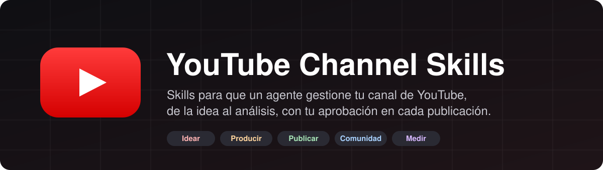
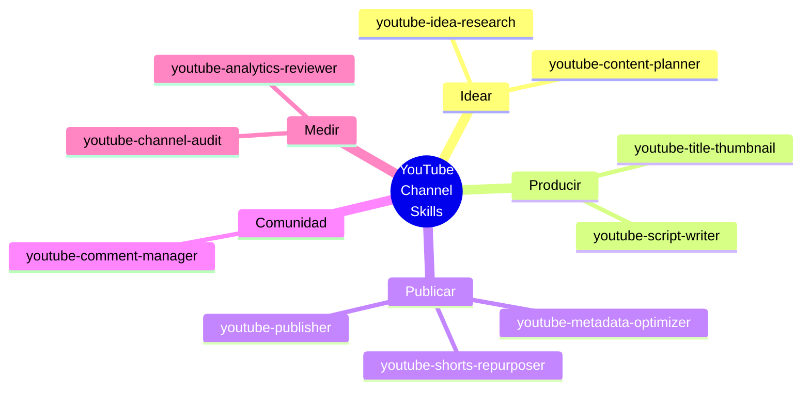
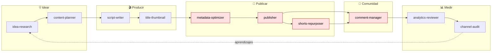
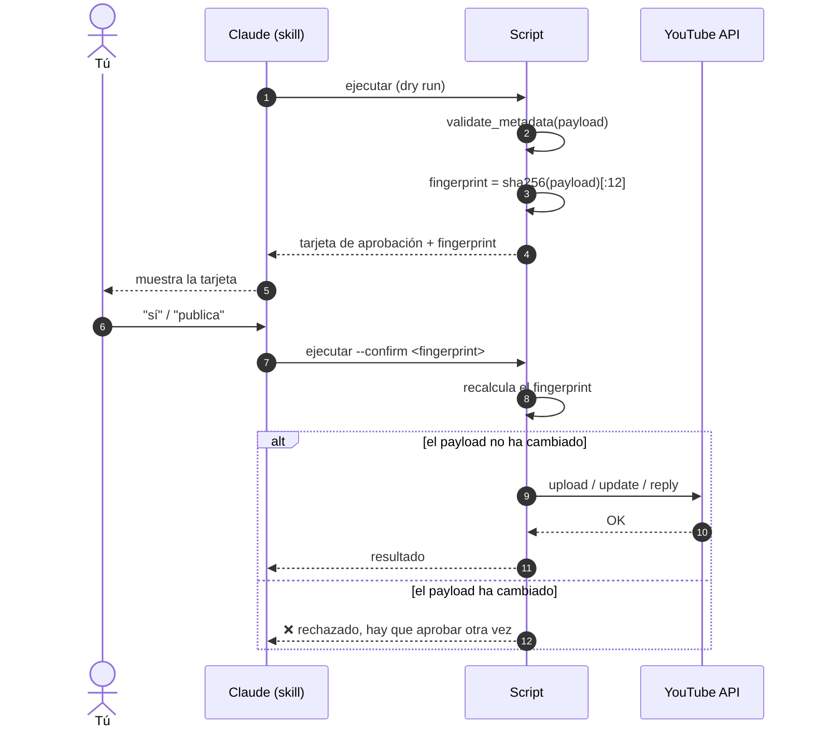
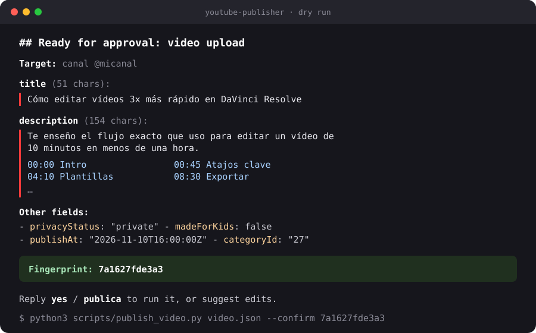
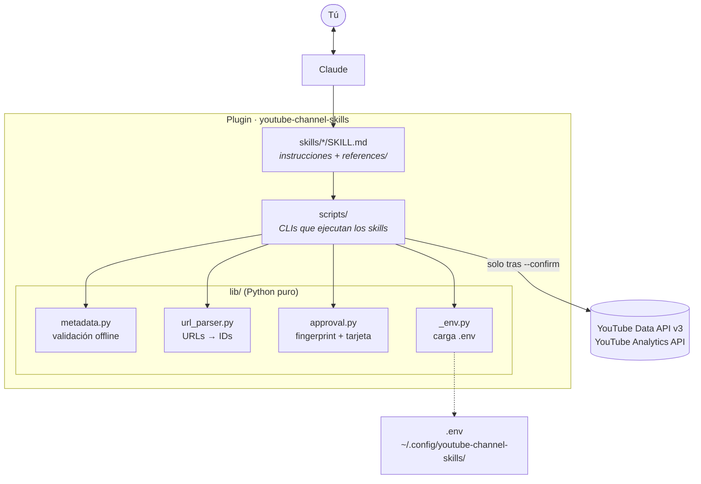

<p align="center">
  
</p>

<p align="center">
  <b>Un conjunto de skills para Claude que gestiona un canal de YouTube de principio a fin:</b><br>
  investigar ideas, planificar, escribir guiones, optimizar títulos y metadatos, publicar,<br>
  convertir en Shorts, responder comentarios y analizar resultados.
</p>

<p align="center">
  
  
  
  
</p>

---

## Índice

- [Qué es](#qué-es)
- [Los 10 skills](#los-10-skills)
- [El ciclo de vida de un vídeo](#el-ciclo-de-vida-de-un-vídeo)
- [Seguridad: la puerta de aprobación](#seguridad-la-puerta-de-aprobación)
- [Arquitectura](#arquitectura)
- [Librería compartida (`lib/`)](#librería-compartida-lib)
- [Validación de metadatos](#validación-de-metadatos)
- [Instalación y configuración](#instalación-y-configuración)
- [Estructura del repositorio](#estructura-del-repositorio)
- [Hoja de ruta](#hoja-de-ruta)

---

## Qué es

**YouTube Channel Skills** es un plugin de skills para Claude (Claude Code y compatibles). Cada skill se encarga de una tarea concreta de la gestión de un canal. Juntos cubren el ciclo completo de un vídeo.

Hay tres principios en todo el diseño:

1. **Nada se publica sin tu "sí".** Toda acción que escribe en YouTube (subir, editar metadatos, responder o moderar comentarios) pasa por una [puerta de aprobación](#seguridad-la-puerta-de-aprobación) con fingerprint.
2. **Se valida antes de llamar a la API.** Los límites de YouTube (100 caracteres de título, 5000 bytes de descripción, 500 de tags, reglas de capítulos, COPPA…) se comprueban en local, sin red.
3. **Funciona con Python sin dependencias.** Los helpers puros (validación, URLs, aprobación) no necesitan paquetes de terceros. Los clientes de la API de Google se importan solo cuando hacen falta, así que los tests offline corren en un Python recién instalado.

---

## Los 10 skills



| Fase | Skill | Qué hace | ¿Escribe en YouTube? |
|---|---|---|:---:|
| 💡 Idear | [`youtube-idea-research`](skills/youtube-idea-research/) | Busca temas con demanda: tendencias, huecos de la competencia, preguntas de la audiencia. | — |
| 💡 Idear | [`youtube-content-planner`](skills/youtube-content-planner/) | Convierte las ideas en un calendario editorial con pilares, formatos y fechas. | — |
| 🎬 Producir | [`youtube-script-writer`](skills/youtube-script-writer/) | Escribe guiones con gancho, estructura por bloques, retención y CTA. | — |
| 🎬 Producir | [`youtube-title-thumbnail`](skills/youtube-title-thumbnail/) | Propone títulos y conceptos de miniatura pensados para el CTR. | — |
| 🚀 Publicar | [`youtube-metadata-optimizer`](skills/youtube-metadata-optimizer/) | Optimiza descripción, capítulos, tags y hashtags, y los valida contra los límites. | ✅ con aprobación |
| 🚀 Publicar | [`youtube-publisher`](skills/youtube-publisher/) | Sube el vídeo o lo programa (`publishAt`) con sus metadatos y su privacidad. | ✅ con aprobación |
| 🚀 Publicar | [`youtube-shorts-repurposer`](skills/youtube-shorts-repurposer/) | Saca momentos de un vídeo largo y los prepara como Shorts (≤ 180 s). | ✅ con aprobación |
| 💬 Comunidad | [`youtube-comment-manager`](skills/youtube-comment-manager/) | Clasifica comentarios, redacta respuestas y propone moderación. | ✅ con aprobación |
| 📊 Medir | [`youtube-analytics-reviewer`](skills/youtube-analytics-reviewer/) | Lee las métricas (CTR, retención, vistas) y saca conclusiones accionables. | — |
| 📊 Medir | [`youtube-channel-audit`](skills/youtube-channel-audit/) | Audita el canal entero: SEO, consistencia, playlists, branding y oportunidades. | — |

> Cada skill vive en `skills/<nombre>/` con su `SKILL.md` y una carpeta `references/` que contiene el conocimiento que el skill carga bajo demanda.

---

## El ciclo de vida de un vídeo

Los skills se encadenan: lo que aprendes al medir alimenta la siguiente ronda de ideas.



<sub>En rojo, los skills que escriben en YouTube y por eso siempre pasan por la puerta de aprobación.</sub>

### Ejemplo de conversación

```text
Tú:      Quiero un vídeo sobre editar más rápido en DaVinci Resolve.
Claude:  [youtube-idea-research]    3 ángulos con demanda + competidores
         [youtube-script-writer]    guion de 10 min con gancho en los primeros 15 s
         [youtube-title-thumbnail]  5 títulos y 3 conceptos de miniatura
         [youtube-metadata-optimizer] descripción, capítulos y tags validados
         [youtube-publisher]        tarjeta de aprobación (fingerprint 7a1627fde3a3)
Tú:      publica
Claude:  Vídeo programado para el 10/11 a las 16:00 UTC (privado → público).
```

---

## Seguridad: la puerta de aprobación

Toda acción de escritura se ejecuta **en dos pasadas**. Así apruebas los bytes exactos que se van a publicar, no un resumen.



Así se ve la tarjeta que genera `render_approval_card()`:

<p align="center">
  
</p>

**Reglas de la puerta:**

- El fingerprint es `sha256` del JSON canónico (claves ordenadas, sin espacios), truncado a 12 caracteres.
- Si cambia un solo carácter del título, de la descripción o de un tag, el fingerprint cambia y la ejecución se rechaza.
- **El agente nunca inventa un fingerprint.** Solo copia el de una tarjeta que tú has visto y aprobado.
- Si la validación devuelve algún `error`, la tarjeta lo indica y no se puede publicar hasta corregirlo.

---

## Arquitectura



---

## Librería compartida (`lib/`)

| Módulo | Exporta | Para qué sirve |
|---|---|---|
| [`metadata.py`](lib/metadata.py) | `validate_metadata`, `parse_chapters`, `count_hashtags`, `tags_length`, `Issue` | Valida un `video.json` contra los límites de YouTube sin conexión. |
| [`url_parser.py`](lib/url_parser.py) | `parse_youtube_url`, `ParsedYouTubeUrl` | Convierte cualquier URL de YouTube en IDs (vídeo, Short, directo, canal, @handle, playlist, comentario `lc=`, tiempo `t=`). |
| [`approval.py`](lib/approval.py) | `fingerprint`, `render_approval_card`, `verify_confirmation` | Implementa la puerta de aprobación en dos pasadas. |
| [`_env.py`](lib/_env.py) | `load_env`, `get` | Cargador mínimo de `.env` (sin `python-dotenv`). Las variables de la shell tienen prioridad. |

```python
from lib import parse_youtube_url, validate_metadata, render_approval_card

parse_youtube_url("https://youtu.be/dQw4w9WgXcQ?t=1m30s")
# ParsedYouTubeUrl(kind='video', video_id='dQw4w9WgXcQ', start_seconds=90, ...)

issues = validate_metadata(video, duration_seconds=640)
print(render_approval_card(kind="video upload", payload=video, issues=issues))
```

### URLs aceptadas

```mermaid
flowchart LR
    IN["entrada"] --> P{parse_youtube_url}
    P -->|watch?v= · youtu.be · embed| V[video]
    P -->|/shorts/ID| S[short]
    P -->|/live/ID| L[live]
    P -->|/channel/UC… · UC…| CH[channel]
    P -->|/@handle · @handle| H[handle]
    P -->|/playlist?list=| PL[playlist]
    P -->|otro dominio| X[unknown]
```

---

## Validación de metadatos

`validate_metadata()` devuelve una lista de `Issue` con nivel `error` (bloquea la publicación) o `warn` (consejo).

| Campo | Regla | Nivel |
|---|---|:---:|
| `title` | Obligatorio, ≤ 100 caracteres | error |
| `title` | Más de ~70 caracteres se trunca en búsqueda y sugeridos | warn |
| `title` | Todo en mayúsculas parece spam | warn |
| `title` / `description` | No puede contener `<` ni `>` (la API lo rechaza) | error |
| `description` | ≤ 5000 **bytes** (UTF-8) | error |
| `description` | La primera línea debería llevar el gancho (se ven unos 150 caracteres) | warn |
| hashtags | Con más de 15, YouTube los ignora todos | error |
| hashtags | Lo recomendable son 3 a 5 | warn |
| capítulos | Primer capítulo en `00:00`, mínimo 3, en orden ascendente, cada uno de 10 s o más | error |
| `tags` | ≤ 500 caracteres contados como lo hace YouTube (comillas y comas incluidas) | error |
| `privacyStatus` | `private` · `unlisted` · `public` | error |
| `madeForKids` | **Hay que declararlo siempre** (es una declaración legal, COPPA) | error |
| `publishAt` | ISO 8601 con zona horaria, en el futuro, y el vídeo en `private` | error |
| `categoryId` | Numérico (`"22"` People & Blogs, `"27"` Education…) | error |
| `isShort` | Duración ≤ 180 s | error |

<details>
<summary><b>Ejemplo de <code>video.json</code></b></summary>

```json
{
  "title": "Cómo editar vídeos 3x más rápido en DaVinci Resolve",
  "description": "Te enseño el flujo exacto que uso para editar un vídeo de 10 minutos en menos de una hora.\n\n00:00 Intro\n00:45 Atajos clave\n04:10 Plantillas\n08:30 Exportar",
  "tags": ["davinci resolve", "edición de vídeo"],
  "categoryId": "27",
  "privacyStatus": "private",
  "publishAt": "2026-11-10T16:00:00Z",
  "madeForKids": false
}
```
</details>

---

## Instalación y configuración

> ⚠️ **En desarrollo.** El manifiesto del plugin (`.claude-plugin/`) y los scripts todavía no están en el repo, así que estos pasos pueden cambiar.

```bash
# 1. Clona el repositorio
git clone <url-del-repo> youtube-channel-skills
cd youtube-channel-skills

# 2. (Opcional) Dependencias de Google, solo para los skills que llaman a la API
pip install google-api-python-client google-auth-oauthlib

# 3. Configuración local
cp .env.example .env   # credenciales OAuth de la YouTube Data API v3
```

- **Credenciales:** crea un proyecto en Google Cloud, activa *YouTube Data API v3* (y *YouTube Analytics API* para los skills de análisis) y genera un cliente OAuth de tipo *Desktop*.
- **Directorio de configuración:** por defecto `~/.config/youtube-channel-skills/`. Se puede cambiar con `YT_SKILLS_CONFIG_DIR`.
- **Prioridad:** las variables de la shell siempre tienen prioridad sobre las del `.env`.

---

## Estructura del repositorio

```text
youtubeChanelSkill/
├── .claude-plugin/            # manifiesto del plugin
├── .github/workflows/         # CI (tests offline)
├── docs/images/               # imágenes del README
├── lib/                       # librería compartida, Python puro
│   ├── __init__.py
│   ├── _env.py
│   ├── approval.py
│   ├── metadata.py
│   └── url_parser.py
├── references/                # conocimiento compartido (p. ej. metadata-limits.md)
├── scripts/                   # CLIs que invocan los skills
├── skills/
│   ├── youtube-idea-research/
│   │   ├── SKILL.md
│   │   └── references/
│   ├── youtube-content-planner/
│   ├── youtube-script-writer/
│   ├── youtube-title-thumbnail/
│   ├── youtube-metadata-optimizer/
│   ├── youtube-publisher/
│   ├── youtube-shorts-repurposer/
│   ├── youtube-comment-manager/
│   ├── youtube-analytics-reviewer/
│   └── youtube-channel-audit/
└── tests/                     # tests sin red
```

---

## Hoja de ruta

- [x] Validación offline de metadatos (`lib/metadata.py`)
- [x] Parser de URLs de YouTube (`lib/url_parser.py`)
- [x] Puerta de aprobación con fingerprint (`lib/approval.py`)
- [x] Cargador de `.env` sin dependencias (`lib/_env.py`)
- [ ] `SKILL.md` de los 10 skills
- [ ] `references/metadata-limits.md`, sincronizado con `lib/metadata.py`
- [ ] Scripts CLI: upload, update-metadata, comments, analytics
- [ ] Tests offline y workflow de CI
- [ ] Manifiesto `.claude-plugin/plugin.json`
